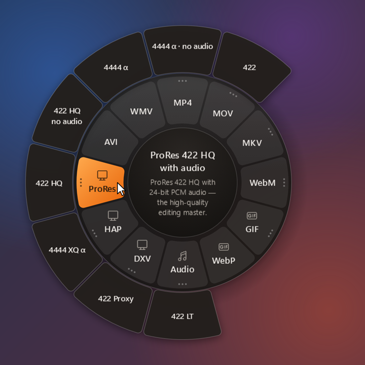
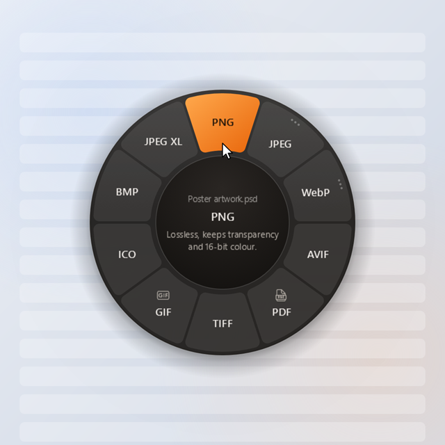
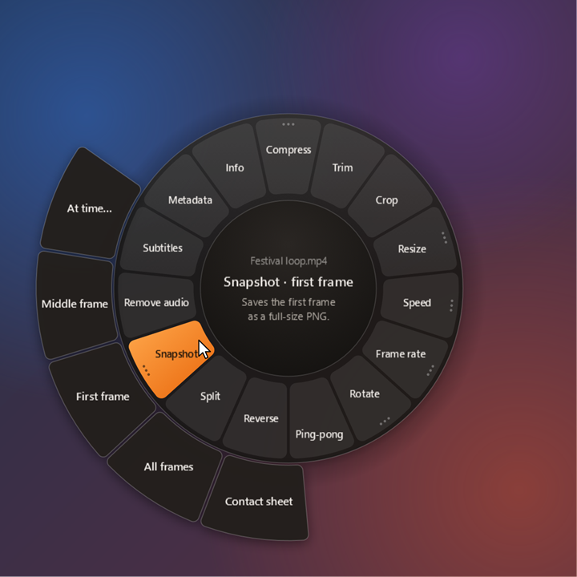
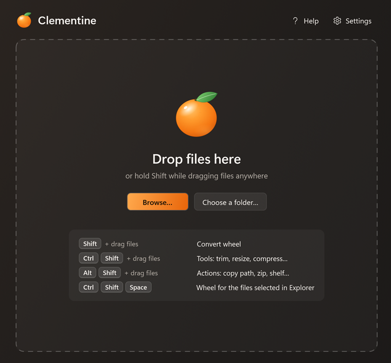
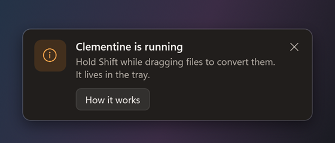

<p align="center">
  
</p>

<h1 align="center">Clementine</h1>

<p align="center">
  <b>Hold Shift while dragging files. Pick a format. Done.</b><br>
  A free, open-source file converter for Windows that lives in your tray and works wherever you drag files.
</p>

<p align="center">
  
</p>

Hold **Shift** while you drag files — in Explorer, on the desktop, from almost any app — and a wheel of formats
appears under the pointer. Drop on a format and the result is saved **next to the original**. Your originals are
never changed, nothing is uploaded anywhere, and there's nothing else to install.

| Hold while dragging | Wheel | For example |
|---|---|---|
| **Shift** | Convert | MP4 → DXV / HAP / ProRes, PSD → PNG, HEIC → JPEG, Markdown → PDF, WAV → MP3 |
| **Ctrl + Shift** | Tools | trim, compress to a size, resize, crop, speed, ping-pong loop, merge PDFs |
| **Alt + Shift** | Actions | copy path, zip, checksum, move to…, pin to the shelf |

<table>
  <tr>
    <td width="50%"></td>
    <td width="50%"></td>
  </tr>
  <tr>
    <td></td>
    <td></td>
  </tr>
</table>

## Contents

- [Features](#features)
- [Download and install](#download-and-install)
- [Using Clementine](#using-clementine)
- [Privacy](#privacy)
- [Building from source](#building-from-source)
- [Releasing](#releasing)
- [Licence](#licence)

## Features

### Video for VJs

DXV, HAP and ProRes are first-class, with and without alpha where the codec allows it, and with or without audio.

| Codec | Variants | Notes |
|---|---|---|
| **DXV** (Resolume DXV3) | with audio · no audio | Normal Quality (DXT1). **No alpha**: FFmpeg can't encode DXV alpha, so use HAP Alpha or ProRes 4444 for transparency. |
| **HAP** | HAP · HAP Alpha · HAP Q — each with or without audio | GPU-decoded, very light on the CPU in Resolume. |
| **ProRes** | 422 HQ · 4444 α — each with or without audio; 422 · 422 LT · 422 Proxy · 4444 XQ α with audio | `prores_ks`, 10-bit, alpha in 4444 and 4444 XQ. |

- Audio in these files is PCM at 48 kHz: 16-bit for DXV/HAP, 24-bit for ProRes.
- Variable-frame-rate phone clips become constant frame rate, interlaced footage is deinterlaced, and colours are
  converted with the right BT.709/601 matrix. HDR is tone-mapped, except in ProRes (which keeps it).
- Alpha variants keep the source's transparency (ProRes 4444, PNG/QTRLE MOV, VP9-alpha WebM, GIF…) and warn you
  when the source has none.
- Outputs say what they are: `clip (DXV).mov`, `clip (HAP Alpha).mov`, `clip (ProRes 4444).mov`.

### Everything else

More than 250 operations, all running locally:

- **Video** — MP4 (H.264/H.265, GPU-accelerated when available), MOV, MKV (remux without re-encoding), WebM (VP9,
  VP9 alpha, AV1), GIF, animated WebP, AVI, WMV, extract audio. Tools: compress (to a target size, too), trim, crop,
  resize, speed, frame rate, rotate/flip, reverse, ping-pong loop, split, join, snapshots and contact sheets, image
  sequence → video, burn in or extract subtitles, remove audio or metadata, media info.
- **Audio** — MP3, M4A (AAC/ALAC), WAV, FLAC, OGG, Opus, AIFF. Tools: trim, normalise (−14/−16/−23 LUFS, peak),
  volume, channels, speed, fade, bleep, compress, split (also on silence), join, reverse, waveform video.
- **Images** — reads PSD/PSB (with a layer fallback for files saved without a composite), HEIC, camera RAW, SVG, WebP,
  AVIF, JPEG XL, TIFF, ICO, EXR and more; writes PNG, JPEG, WebP, AVIF, JPEG XL, TIFF, BMP, GIF, ICO and PDF. Tools:
  resize, compress to a size, crop, rotate, adjust, transparent background, export PSD layers, strip metadata or just
  the location, read QR/barcodes, images → PDF, collage.
- **PDF** — to PNG/JPEG/TXT/DOCX, merge, split, extract/delete/reorder/rotate pages, compress, protect, unlock,
  edit or remove metadata, info.
- **Documents** — Word (DOCX) → PDF/HTML/TXT, Excel (XLSX) and CSV → PDF/HTML, XLSX ↔ CSV, PowerPoint (PPTX) →
  text, Markdown → HTML/PDF/DOCX, HTML and EPUB → PDF/TXT, TXT → PDF/DOCX, Pages/Numbers/Keynote → PDF preview.
  With LibreOffice installed: PowerPoint → PDF and PNG slides, the older and OpenDocument formats (.doc, .xls, .ppt,
  .odt, .ods, .odp, .rtf…), and conversions between DOCX/DOC/ODT/RTF, XLSX/ODS and PPTX/ODP. When it's there,
  Word and Excel → PDF use it too, for the closest match to the original layout.
- **Archives** — extract (also with a password), list, test, repack to ZIP/TAR/TAR.GZ/7Z; compress folders and
  selections. Zip-slip and zip-bomb protection built in.
- **Subtitles and data** — SRT/VTT/ASS/TXT, shift timing, change frame rate, clean up, fix encoding;
  JSON ↔ YAML, JSON ↔ CSV, XML → JSON, pretty-print/minify.
- **Actions** — copy paths, copy/move to a folder, show in folder, open a terminal here, open with…, rename with a
  pattern, duplicate, checksums (SHA-256/SHA-1/MD5/CRC32), and the **shelf**: a floating window that holds files so
  you can drag them out again later.

## Download and install

1. Open the [**latest release**](../../releases/latest) and download **`Clementine-Setup.exe`**.
2. Run it. It installs for your user only — **no administrator rights** needed — adds Start-menu and desktop
   shortcuts and starts Clementine, which then lives in the tray.
3. Windows SmartScreen may say *"Windows protected your PC"*, because the installer isn't code-signed yet. Click
   **More info → Run anyway**.

Prefer not to install? Download **`Clementine-Portable.zip`**, unzip it anywhere and run `Clementine.exe`.

**Requirements:** Windows 10 or 11, 64-bit.

### Nothing else to install

Everything Clementine needs ships with it:

- **FFmpeg** (video and audio) and **7-Zip** (.7z archives) are bundled.
- **Microsoft Edge**, which is part of Windows, prints HTML, Markdown, e-books and Clementine's own Word and Excel
  conversions to PDF.
- **LibreOffice** is optional. Word and Excel files already convert to PDF without it (very complex layouts may come
  out a little different). Install it ([libreoffice.org](https://www.libreoffice.org/)) if you also want PowerPoint
  files turned into PDFs or images, or older and OpenDocument formats (.doc, .xls, .ppt, .odt…) converted. Without
  it those segments are simply greyed out with a note; Settings › Tools shows what was found.

### Updates

Clementine keeps itself up to date from this repository's [Releases](../../releases/latest):

- A minute after it starts, and then every 6 hours while it runs, it asks GitHub whether a newer **stable** release
  is out (pre-releases are skipped). If there is one, it downloads it quietly in the background — only the
  changed parts when it can.
- When the download is ready, a card says *"Clementine 0.1.3 is ready"* with **Restart to update**, and the tray
  menu shows **Restart to update (0.1.3)** until you do. Nothing is installed until you choose to: restarting
  cancels running jobs (it asks first, like Quit), installs the new version in a few seconds and brings Clementine
  back to the tray, with your settings and shortcuts as they were.
- **Settings › About › Check for updates** checks right away and shows what happened ("You're up to date",
  "Downloading 0.1.3…", "Couldn't reach GitHub — try again later"). Turn off **Check for updates automatically** in
  **Settings › General** to stop the scheduled checks; the button still works when you want it.
- Being offline, GitHub's rate limit or a release without update files never interrupts you: the check simply tries
  again later (details go to the log).

Copies installed with `Clementine-Setup.exe` and unzipped portable copies both update this way. Builds from source
never do. You can always update by hand too: run the newest `Clementine-Setup.exe` over the installed version.

### Uninstalling

Uninstall from **Windows Settings › Apps**; everything Clementine registered (startup entry, Explorer menu, Send To
shortcut) is removed with it. For a portable copy, run `Clementine.exe --unregister` before deleting the folder.

## Using Clementine

| How | What happens |
|---|---|
| **Shift** + drag files | Convert wheel under the pointer |
| **Ctrl + Shift** + drag files | Tools wheel |
| **Alt + Shift** + drag files | Actions wheel |
| **Ctrl + Shift + Space** | Wheel for the files selected in Explorer (or on the desktop) |
| Click the **tray icon** | Main window: drop or browse files, pick from tiles, see recent jobs |
| Right-click the tray icon | Open, Jobs, Pause wheel, Settings, Help, Quit |
| Right-click a file › **Convert with Clementine** | Wheel for that file (turn on in Settings › Explorer, which also offers a **Send To** shortcut) |

- The **inner ring** holds formats or tools; hover one and its **variants** fan out on the outer ring. Dropping on
  the inner segment uses the recommended variant.
- Drop on the centre, press **Esc** or let go somewhere else to cancel. Switch wheels mid-drag by changing the keys.
- Results are saved next to the original (or in a folder you choose in Settings › Output). Existing files are never
  overwritten: you get `clip (2).mov` instead. A cancelled job leaves nothing behind.
- Tools that need settings (trim, target size, page ranges…) ask in a small dialog and remember your choices.
- Progress, results and errors appear as cards above the taskbar, with **Show in folder** and **Open**.
- Every shortcut can be changed in **Settings › Wheel**, and Settings › General can start Clementine with Windows.

## Privacy

Everything happens on your PC. Clementine has no accounts, no telemetry and no analytics, and your files never leave
your machine.

The **only** network access is the optional update check: it reads the list of releases of this repository and
their small update-feed files from GitHub (`api.github.com`, and `github.com` release downloads, which GitHub
redirects to its own download servers) and, when there is a new version, downloads it from the release. It sends nothing about you
or your files — no account, token, ID or usage data, just the ordinary request any browser would make, so GitHub
sees your IP address. Turn it off in **Settings › General › Check for updates automatically**; then Clementine
makes no network requests at all unless you press **Check for updates** in Settings › About.

Web pages, e-books and documents are printed to PDF in a locked-down Edge with a throw-away profile and all network
requests blocked, so a page can't run scripts or phone home. Settings are stored in `%APPDATA%\Clementine` and logs
(which contain file names, for troubleshooting) in `%LOCALAPPDATA%\Clementine\logs`.

## Building from source

You need Windows 10/11 x64 and the [.NET 10 SDK](https://dotnet.microsoft.com/download/dotnet/10.0). FFmpeg on your
PATH is needed for the media tests (and for video/audio when running a development build), e.g.
`winget install Gyan.FFmpeg`. LibreOffice is optional; its tests skip when it's missing.

Everything goes through `build.ps1`. It serialises builds with a machine-wide lock (so several terminals never fight
over `obj/bin`), prefers a user-local SDK in `%LOCALAPPDATA%\Microsoft\dotnet` when there is one, and puts all build
output in `%LOCALAPPDATA%\ClementineBuild` so `bin/obj` stay out of the source tree.

```powershell
.\build.ps1                                   # build the whole solution
.\build.ps1 build src\Clementine.Engines.Media
.\build.ps1 test                              # every test (~1,200; a hung test host is aborted after 10 min)
.\build.ps1 test tests\Clementine.Engines.Media.Tests --filter "FullyQualifiedName~ProRes"
.\build.ps1 cli list "D:\Clips\loop.mp4"      # what Clementine offers for a file
.\build.ps1 cli run video.dxv.audio --out D:\Out "D:\Clips\loop.mp4"
.\build.ps1 cli tools                         # which external tools were found
.\build.ps1 app                               # build and run Clementine.exe
.\build.ps1 app --snapshot-ui D:\Shots        # render every window and wheel state to PNG
.\build.ps1 dotnet <anything>                 # any dotnet command under the same lock
```

From another shell: `powershell -NoProfile -ExecutionPolicy Bypass -File .\build.ps1 <verb> …`

### Building the installer

```powershell
.\publish.ps1                    # version from Directory.Build.props
.\publish.ps1 -Version 0.2.0
```

`publish.ps1` publishes a self-contained Release build (no .NET needed on the target PC), downloads the pinned FFmpeg
and 7-Zip packages (verified against SHA-256 hashes) and bundles them as `tools\ffmpeg` and `tools\7zip` inside the
app, with their licences in `licenses\`, then packs everything with
[Velopack](https://velopack.io) (`vpk`, a local tool pinned in `dotnet-tools.json`). It needs **7-Zip installed** on
the build machine to unpack those packages (`winget install 7zip.7zip`).

It writes `Clementine-Setup.exe` and `Clementine-Portable.zip` to `Clementine Product\Windows` **next to** the
repository folder (plus a VA Plugin Store copy in `Clementine Product\VA\Clementine <version> - VA`), and the Velopack
release feed (full/delta `.nupkg`, `releases.win.json`) to `releases\` (git-ignored).

The architecture, the rules every operation follows and how to add one are in
[docs/ARCHITECTURE.md](docs/ARCHITECTURE.md); the contributor checklist is in [CONTRIBUTING.md](CONTRIBUTING.md).

## Releasing

**Before the first release**, set `<ClementineUpdateRepo>` in `Directory.Build.props` to this repository's URL,
exactly as GitHub shows it (`https://github.com/<owner>/<repo>`). It is compiled into `Clementine.exe` as the update
source: installed copies check that repository's Releases (stable releases only). Leave it empty to build a copy that
never checks. The Release workflow refuses to publish when it names a different repository, so a wrong update source
can never ship.

Installed copies find updates through the Velopack files each release carries (`releases.win.json` and the
`.nupkg` packages, uploaded by `vpk upload github`); a release without them is ignored by the update check. Mark a
release as a pre-release (or tag it `v0.2.0-beta.1`) to keep it from being offered.

**With GitHub Actions (recommended):** bump `<Version>` in `Directory.Build.props`, commit, then push a tag:

```powershell
git tag v0.2.0
git push origin v0.2.0
```

The [Release workflow](.github/workflows/release.yml) first runs the whole [CI workflow](.github/workflows/ci.yml)
(build and every test project) on the tagged commit and stops if anything fails. It then fetches the source code of
the bundled FFmpeg and 7-Zip versions (pinned SHA-256), downloads the previous release (for delta packages), runs
`publish.ps1`, and uploads the installer, the portable zip, the packages, the release feed and the two source
archives to a **draft** GitHub release "Clementine 0.2.0". Only when the draft holds every one of those files does it
publish the release, so installed copies never see a release without its installer or its FFmpeg and 7-Zip source.
If a run fails part-way, delete the leftover draft on GitHub before pushing the tag again. Tags with a suffix
(`v0.2.0-beta.1`) become pre-releases.

When `publish.ps1` moves to another FFmpeg or 7-Zip version, add that version's source archive (URL and SHA-256) to
`.github/scripts/release-sources.ps1`; releases fail until it is there.

**By hand:**

```powershell
.\build.ps1 dotnet vpk download github --outputDir releases --repoUrl https://github.com/<owner>/clementine   # optional: delta packages
.\publish.ps1 -Version 0.2.0
powershell -NoProfile -ExecutionPolicy Bypass -File .github\scripts\release-sources.ps1   # → releases\sources
.\build.ps1 dotnet vpk upload github --outputDir releases --repoUrl https://github.com/<owner>/clementine `
    --token <token> --releaseName "Clementine 0.2.0" --tag v0.2.0            # a draft: no --publish
gh release upload v0.2.0 "..\Clementine Product\Windows\Clementine-Setup.exe" `
    "..\Clementine Product\Windows\Clementine-Portable.zip" (Get-ChildItem releases\sources -File).FullName
gh release edit v0.2.0 --draft=false                                         # publish once every file is there
```

`<token>` is a GitHub token with `contents: write` on the repository. `vpk` uploads the Velopack-named files
(`ClementineApp-win-Setup.exe`, `ClementineApp-win-Portable.zip`, …) to a draft release; `gh release upload` adds the
friendly copies (`Clementine-Setup.exe`, `Clementine-Portable.zip`) and the source archives from `releases\sources`,
so the download instructions above match and the FFmpeg and 7-Zip source sits next to the programs that include them.
Publish the draft only after that, since installed copies start downloading a release as soon as it is public.
Publishing creates the tag on GitHub, which also starts the Release workflow; its first job sees the release is
already published and stops, so nothing is built twice.

## Licence

Clementine is free and open source under the [MIT licence](LICENSE). © 2026 Visual Artform.

It stands on the shoulders of other open-source projects, each under its own licence — see
[THIRD-PARTY-NOTICES.txt](src/Clementine.App/THIRD-PARTY-NOTICES.txt), which ships next to `Clementine.exe` and
appears in Settings › About:

- **FFmpeg** 8.1.2 (GPLv3 build by gyan.dev) and **7-Zip** 25.01 (`7za.exe`, LGPL-2.1 with BSD-3-Clause and
  BSD-2-Clause parts) are bundled as separate programs that Clementine starts; they are not linked into it. Their
  licences and the FFmpeg build configuration are installed in the `licenses` folder next to `Clementine.exe`, and
  every [release](../../releases) carries the source code of the exact FFmpeg and 7-Zip versions it bundles
  (`ffmpeg-<version>.tar.xz`, `7z<version>-src.7z`). The FFmpeg build also compiles in the external libraries listed,
  with their versions, in `licenses\FFmpeg-BUILD-README.txt`. **Written offer:** for at least three years after the
  last Clementine release that includes this FFmpeg build, Visual Artform will give anyone who asks a complete copy of
  its corresponding source (FFmpeg and every one of those libraries, at those versions), free of charge as a
  download; [open an issue](../../issues) titled "FFmpeg source request". The same offer is in
  `licenses\FFmpeg-SOURCE.txt` and `THIRD-PARTY-NOTICES.txt`.
- Libraries are MIT, Apache-2.0 or BSD licensed. Magick.NET's native library includes some LGPL components (full
  texts in `licenses\Magick.NET-Notice.txt`). PDFsharp is deliberately pinned to the MIT-licensed 6.2.x line.
  Velopack (MIT) provides the installer and the update check.
- LibreOffice (optional) and Microsoft Edge (part of Windows) are separate programs that Clementine calls when
  they're installed; neither is included.
